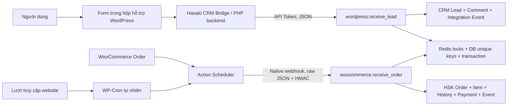

# IMPLEMENTATION REPORT — A4.8

## 1. Kết quả và căn cứ nghiệm thu

Ngày tổng kết **24/11/2026**. Source triển khai bám Technical Contract v1.1; phụ lục được ưu tiên. Căn cứ gồm source trong App, metadata MariaDB đọc lại và kết quả test thật. Không coi tài liệu thiết kế là bằng chứng tính năng đã chạy.

- Đủ 5 DocType có JSON/controller/permission, hai Child Table và ba unique index. Backup trước migrate; migrate crm.localhost thành công.
- Lead Form WordPress → API Token → CRM Lead/Comment/Event đã chạy trên website thật.
- WooCommerce native order.created/order.updated → HMAC → Order/Item/History/Payment/Event đã chạy; có chống trùng và phiên bản cũ.
- **37/37 test case Passed**: 13 Lead, 18 WooCommerce, 6 schema/controller. Xem [TEST_REPORT.md](TEST_REPORT.md).
- WP-Cron tự động **Passed**: đơn 1944 → HSK-ORD-2026-00056, Payment test HSK-PAY-2026-00057; không chạy action thủ công. Quan sát 35.88 giây, không thay cho soak test dài hạn.
- 200 SKU WordPress khớp 200 CRM Product. Bản ghi và metadata sản phẩm, file/theme đang dùng và các plugin cũ được bảo toàn.

## 2. Môi trường thực tế

| Thành phần | Giá trị xác nhận |
| --- | --- |
| App | hasaki_integration 0.0.1, module Hasaki Integration |
| Site / Container | crm.localhost / crm-frappe-1 |
| Frappe / CRM | 15.127.1 / 1.92.0 |
| Source Windows | C:\Users\Yen Nhi\frappe-crm\hasaki_integration |
| Source Docker | /workspace/hasaki_integration |
| Bench | /home/frappe/frappe-bench; apps/hasaki_integration liên kết source mount |
| Database CRM / cache | MariaDB hiện hữu; Redis dùng khóa và dịch vụ nền |
| XAMPP | D:\baitap; Apache port 8080; PHP 8.2.12 |
| WordPress | 7.1.5, D:\baitap\htdocs\shopdongho |
| WooCommerce | 10.9.4; tiền tệ VND |
| URL website | http://localhost:8080/shopdongho/ |
| WordPress database / theme | shopdongho / flatsome-hasaki-child (parent flatsome) |
| Backend WordPress → CRM | http://127.0.0.1:8000 + X-Frappe-Site-Name: crm.localhost |
| Timezone dữ liệu CRM | Asia/Ho_Chi_Minh; UTC nguồn được đổi trước khi lưu Datetime |

Đường dẫn C:\xampp ban đầu không tồn tại trên máy. Website đã được nhận diện từ Apache đang chạy ở D:\baitap, sau đó kiểm tra blogname/theme/database trước khi cấu hình. crm.localhost chưa phân giải trên Windows tại lần kiểm tra; địa chỉ loopback + site header đã ping và tích hợp thành công. Không sửa hosts để đạt kết quả này.

## 3. Kiến trúc

REST xử lý nghiệp vụ đồng bộ trong transaction phía Frappe. Queue phát webhook ở **WordPress**, không phải một scheduler do App CRM tạo. after_request hook chỉ chuẩn hóa lỗi của hai endpoint Hasaki; không thay response của API CRM khác. App yêu cầu CRM qua required_apps, không có fixture tạo Master Data và không có custom Event Bus.

## 4. Chức năng đã triển khai

### 4.1 Lead

Nhận submission_id, first_name, last_name, phone, email, message, consent. Nguồn Web Form phải có sẵn. phone → mobile_no; message được escape và lưu Comment liên kết Lead. consent phải JSON true, không tạo Contact, không thêm custom field Contact. Native Frappe xác thực token trước dispatch; endpoint còn bắt buộc scheme token và quyền create CRM Lead. submission_id chống gửi lặp qua Event và hash canonical JSON.

Plugin dùng nonce, honeypot, giới hạn 10 lần/phút theo bucket IP đã hash, giữ submission ID khi retry và gửi token từ PHP. Retry tối đa một lần cho lỗi truyền/HTTP 5xx với nguyên body. Form gắn vào hsk-support qua plugin footer hook, không sửa theme.

### 4.2 Order/Payment

HMAC-SHA256 raw body, so khớp source store đã cấu hình. SKU bắt buộc tồn tại; Contact được đối chiếu chính xác nếu duy nhất, nếu không giữ guest. Order key woo:store:id; Payment key thêm :payment. Status history do controller giữ; cost_price snapshot theo dòng. Processing không chứng minh Paid nếu thiếu date_paid_gmt.

Event key WooCommerce có cả topic/order ID/Delivery-ID/raw hash để tránh Delivery-ID native trùng trong cùng giây. Sự kiện cũ được acknowledge ignored_stale; cùng timestamp khác hash trả 409. update cho Order chưa tồn tại trả 409 và cần giao lại sau create. Không có retry queue CRM riêng để tự phát lại mọi lỗi.

### 4.3 WP-Cron

Site không bật DISABLE_WP_CRON; action_scheduler_run_queue có interval 60. Bài test mới chỉ tạo/cập nhật giao dịch và GET trang chủ; log action ghi context WP Cron, Apache ghi loopback wp-cron.php 200 tự sinh. Cả pha Pending và Processing/Paid đã tự giao thành công. Không sửa cron core hoặc cấu hình lại scheduler của site.

## 5. Các mốc và dữ liệu minh chứng

| Luồng | WordPress | CRM | Minh chứng |
| --- | --- | --- | --- |
| Form thật | submission trong JSON E2E | CRM-LEAD-2026-00130 + một Comment | test_results_wordpress_e2e.json |
| Native webhook, action được chạy có kiểm soát trước đây | Order 1943 | HSK-ORD-2026-00041 / HSK-PAY-2026-00042 | test_results_woocommerce_e2e.json |
| Native webhook, WP-Cron tự nhiên | Order 1944 | HSK-ORD-2026-00056 / HSK-PAY-2026-00057 | test_results_wp_cron.json |

Payment trong hai luồng trên là xác nhận **test** từ date_paid_gmt; không gọi cổng thanh toán hay thu tiền thật. Giao dịch test được giữ để kiểm tra. Mốc tổng số Document lúc xuất IMPLEMENTATION_STATUS.json: CRM Lead=92, CRM Deal=30, HSK Order=45, HSK Payment=12, HSK Integration Event=209; số lượng có thể tăng nếu demo/test lại.

## 6. Backup và thay đổi ngoài App

- CRM trước migrate: sites/crm.localhost/private/backups/20261124_112115-crm_localhost-database.sql.gz và site_config_backup tương ứng. Có thêm backup trước cấu hình token ngày 24/11 lúc 11:43.
- WordPress trước thay đổi: C:\Users\Yen Nhi\frappe-crm-backups\wordpress-a48-20261124, có SQL, wp-config.php và baseline hash; không restore/import.
- Cài file plugin vào wp-content/plugins/hasaki-crm-bridge/hasaki-crm-bridge.php và activate, giữ các plugin trước đó.
- wp-config.php chỉ thêm include có kiểm tra file tồn tại. Credentials ở file riêng ngoài webroot/repository; tài liệu chỉ nêu tên cấu hình, không chứa giá trị.
- Site config CRM thêm source store hasaki-local; cấp/reuse API Token cho user hiện hữu tuvan@hasaki.example, không tạo User hoặc Role mới. WooCommerce có hai webhook Active ID 1/2.
- Không tạo lại App/site/container, không sửa core Frappe/CRM/WordPress/WooCommerce, không sửa BeautyMatch, không push/merge GitHub.

## 7. Danh sách file source tạo/chỉnh sửa

| File tương đối từ root App | Thay đổi |
| --- | --- |
| `hasaki_integration/hasaki_integration/doctype/__init__.py` | Tạo mới trong A4.8 |
| `hasaki_integration/hasaki_integration/doctype/hsk_integration_event/__init__.py` | Tạo mới trong A4.8 |
| `hasaki_integration/hasaki_integration/doctype/hsk_integration_event/hsk_integration_event.json` | Tạo mới trong A4.8 |
| `hasaki_integration/hasaki_integration/doctype/hsk_integration_event/hsk_integration_event.py` | Tạo mới trong A4.8 |
| `hasaki_integration/hasaki_integration/doctype/hsk_order/__init__.py` | Tạo mới trong A4.8 |
| `hasaki_integration/hasaki_integration/doctype/hsk_order/hsk_order.json` | Tạo mới trong A4.8 |
| `hasaki_integration/hasaki_integration/doctype/hsk_order/hsk_order.py` | Tạo mới trong A4.8 |
| `hasaki_integration/hasaki_integration/doctype/hsk_order_item/__init__.py` | Tạo mới trong A4.8 |
| `hasaki_integration/hasaki_integration/doctype/hsk_order_item/hsk_order_item.json` | Tạo mới trong A4.8 |
| `hasaki_integration/hasaki_integration/doctype/hsk_order_item/hsk_order_item.py` | Tạo mới trong A4.8 |
| `hasaki_integration/hasaki_integration/doctype/hsk_order_status_history/__init__.py` | Tạo mới trong A4.8 |
| `hasaki_integration/hasaki_integration/doctype/hsk_order_status_history/hsk_order_status_history.json` | Tạo mới trong A4.8 |
| `hasaki_integration/hasaki_integration/doctype/hsk_order_status_history/hsk_order_status_history.py` | Tạo mới trong A4.8 |
| `hasaki_integration/hasaki_integration/doctype/hsk_payment/__init__.py` | Tạo mới trong A4.8 |
| `hasaki_integration/hasaki_integration/doctype/hsk_payment/hsk_payment.json` | Tạo mới trong A4.8 |
| `hasaki_integration/hasaki_integration/doctype/hsk_payment/hsk_payment.py` | Tạo mới trong A4.8 |
| `wordpress-plugin/hasaki-crm-bridge/hasaki-crm-bridge.php` | Tạo mới trong A4.8 |
| `scripts/activate_wordpress_bridge.php` | Tạo mới trong A4.8 |
| `scripts/backup_wordpress.php` | Tạo mới trong A4.8 |
| `scripts/build_api_contract.py` | Tạo mới trong A4.8 |
| `scripts/build_handover_docs.py` | Tạo mới trong A4.8 |
| `scripts/build_schemas.py` | Tạo mới trong A4.8 |
| `scripts/inspect_wordpress.php` | Tạo mới trong A4.8 |
| `scripts/inspect_wp_cron.php` | Tạo mới trong A4.8 |
| `scripts/install_wordpress_bridge.ps1` | Tạo mới trong A4.8 |
| `scripts/test_existing_woocommerce.php` | Tạo mới trong A4.8 |
| `scripts/test_existing_wordpress.py` | Tạo mới trong A4.8 |
| `scripts/test_wordpress_bridge.php` | Tạo mới trong A4.8 |
| `scripts/test_wp_cron.py` | Tạo mới trong A4.8 |
| `scripts/validate_handover_docs.py` | Tạo mới trong A4.8 |
| `scripts/verify_existing_wordpress.php` | Tạo mới trong A4.8 |
| `scripts/verify_native_flow.py` | Tạo mới trong A4.8 |
| `scripts/verify_wordpress_catalog.py` | Tạo mới trong A4.8 |
| `hasaki_integration/a48_preflight.py` | Tạo mới trong A4.8; helper test/audit được bổ sung khi tổng kết |
| `hasaki_integration/a48_verify.py` | Tạo mới trong A4.8; helper test/audit được bổ sung khi tổng kết |
| `hasaki_integration/integration.py` | Tạo mới trong A4.8; helper test/audit được bổ sung khi tổng kết |
| `hasaki_integration/local_setup.py` | Tạo mới trong A4.8; helper test/audit được bổ sung khi tổng kết |
| `hasaki_integration/payments.py` | Tạo mới trong A4.8; helper test/audit được bổ sung khi tổng kết |
| `hasaki_integration/validation.py` | Tạo mới trong A4.8; helper test/audit được bổ sung khi tổng kết |
| `hasaki_integration/wordpress.py` | Tạo mới trong A4.8; helper test/audit được bổ sung khi tổng kết |
| `hasaki_integration/woocommerce.py` | Tạo mới trong A4.8; helper test/audit được bổ sung khi tổng kết |
| `hasaki_integration/tests/__init__.py` | Tạo mới trong A4.8; helper test/audit được bổ sung khi tổng kết |
| `hasaki_integration/tests/test_integration_http.py` | Tạo mới trong A4.8; helper test/audit được bổ sung khi tổng kết |
| `hasaki_integration/tests/test_schema.py` | Tạo mới trong A4.8; helper test/audit được bổ sung khi tổng kết |
| `README.md` | Chỉnh sửa mô tả App, triển khai và kết quả |
| `hasaki_integration/hooks.py` | Thêm required_apps và after_request có phạm vi endpoint |

Các file scaffolding __init__.py/modules.txt/patches.txt có sẵn được tái sử dụng nếu không liệt kê là file mới. TECHNICAL_CONTRACT.md do người dùng bổ sung, không phải tài liệu tự sửa nội dung. Các thay đổi .gitignore/.gitattributes đã có trước khi bắt đầu; không nhận là phần triển khai mới.

## 8. Tài liệu và artifact

Sáu Markdown: [IMPLEMENTATION_REPORT.md](IMPLEMENTATION_REPORT.md), [DATA_DICTIONARY.md](DATA_DICTIONARY.md), [API_CONTRACT.md](API_CONTRACT.md), [TEST_REPORT.md](TEST_REPORT.md), [DEMO_GUIDE.md](DEMO_GUIDE.md), [HANDOVER.md](HANDOVER.md).

JSON bằng chứng: DATA_DICTIONARY.json, API_CONTRACT.openapi.json, IMPLEMENTATION_STATUS.json, a48_preflight.json (lịch sử trước triển khai), a48_site_metadata.json, documentation_audit.json, documentation_validation.json, test_results_lead.json, test_results_woocommerce.json, test_results_schema.json, test_results_wordpress_e2e.json, test_results_woocommerce_e2e.json, test_results_woo_native_create.json, test_results_woo_native_update.json, test_results_woo_native_replay.json, test_results_wp_cron.json, wordpress_site_inventory.json, wordpress_preservation.json, wordpress_catalog_compatibility.json. Tên native_create hiện lưu mode resume-created của lần phát lại thành công; không diễn giải là một lần clean create mới.

## 9. Phạm vi bàn giao

Nhi tạm sở hữu 5 schema theo phụ lục v1.1 trên local; nhóm cần rà soát sở hữu trước merge. Loyalty, Refund, Voucher và Reporting chỉ nhận interface hướng dẫn trong HANDOVER; chưa có nghiệp vụ các module này trong App. Không khẳng định đã clean-install ở máy khác, đã thu/hoàn tiền thật, hay đã soak-test WP-Cron nhiều giờ/ngày. Các giới hạn và test chưa thực hiện nằm trong TEST_REPORT.
